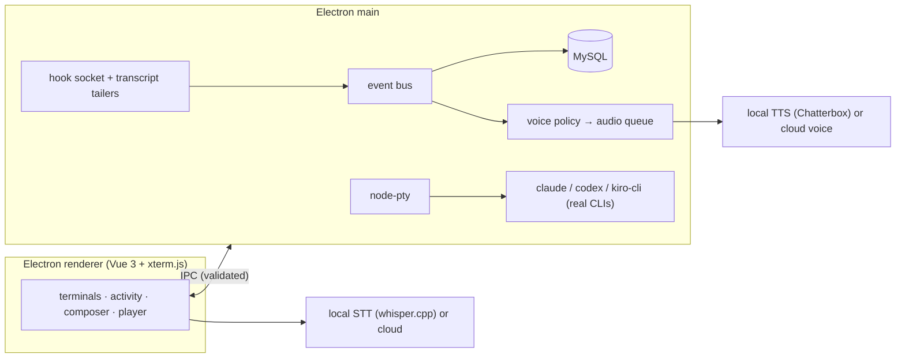

<p align="center">
  
</p>

<p align="center">
  <a href="LICENSE"></a>
  
  
  
</p>

<h3 align="center">A local-first desktop workspace for talking to your coding agents — by keyboard or by voice.</h3>

uTerm keeps the **real, interactive [Claude Code](https://www.anthropic.com/claude-code), [Codex CLI](https://github.com/openai/codex) and
[Kiro CLI](https://kiro.dev)** running in embedded terminals, and adds what the terminal alone does not give you: named and resumable
sessions, folders, a structured activity feed, spoken updates when an agent finishes or needs you, and voice input. Everything
runs on your machine; cloud voices and an English-practice coach are optional.

> It is a workspace around the CLIs, not a replacement for them: uTerm never answers a permission prompt for you and never
> puts a chat UI between you and the agent.

## Features

**Sessions**
- Several agents at once, each in its own terminal. Switching sessions never stops a process.
- Named, resumable sessions (`claude --resume`, `codex resume`, `kiro-cli chat --resume-id`) and one-click import of existing conversations.
- Nested folders with drag and drop, search, and live indicators: running sessions are highlighted with their state (ready, working, needs input, error).
- Several Claude accounts: run a session with its own config folder (for example `~/.claude-work`).
- Installed CLIs are detected automatically (including `~/.local/bin` and Homebrew folders).

**Voice, local by default**
- **Speech to text** with [whisper.cpp](https://github.com/ggml-org/whisper.cpp): record, review and edit the transcription, then send.
- **Spoken replies** with [Chatterbox Turbo](https://github.com/resemble-ai/chatterbox): the agent's progress, questions and results are read aloud according to a per-session mode (silent, essential, balanced, conversational), different for foreground and background sessions.
- Voice cloning from a short reference clip, per-chat voices, playback speed.
- An audio player on every spoken message: scrub, pause and replay from memory.
- Optional NVIDIA GPU for roughly 4–5× faster speech (`./scripts/tts-gpu.sh`).
- STT/TTS run in Docker and can be switched off from the UI to free memory when you do not need them.

**Cloud voice (optional, off by default)**
- Use **Google Gemini** or **OpenAI** voices and transcription instead of, or next to, the local ones; each chat can pick its own voice.
- One picker lists every voice (30 Gemini voices, 13 OpenAI voices, your local ones). A built-in **Test** button checks a key end to end.
- A running **estimate of cloud spend** (today, this month, all time) in the sidebar and in Settings → Usage.

**English coach (optional, off by default)**
- Practise English while you work: after a recording, see your transcription next to a more natural **B2–C1** rewrite and pick one before sending; typed prompts get the natural version shown under them in the activity feed. Display only — what is sent to the agent and what is spoken back never changes. History is kept for review.

**Agent awareness without scraping the screen**
- Claude Code via per-process hooks, Codex via transcript tailing plus hooks, Kiro via its session log — a structured activity feed (prompts, progress, results, errors) next to the terminal.
- Speech-friendly instructions are passed to each agent so long replies end with a short spoken summary (`<voice>…</voice>`) and, with Chatterbox, light expressive tags.

## Requirements
- Linux (developed and tested on Ubuntu). macOS and Windows are untested.
- Node.js ≥ 20, Docker with the Compose plugin (your user in the `docker` group), `build-essential` (for node-pty).
- At least one agent CLI installed and logged in: Claude Code, Codex CLI or Kiro CLI.
- For local voice: roughly 6 GB of RAM free for text-to-speech on CPU (≈ 0.7 GB for speech-to-text); a few GB of disk for models.
  An NVIDIA GPU is optional.

## Quick start
```bash
git clone https://github.com/felipewww/uterm.git
cd uterm
./scripts/setup.sh    # checks prerequisites, creates .env with random local passwords, installs, builds images, downloads models, applies migrations, installs hooks
./scripts/dev.sh      # starts the Docker services and launches the app (development mode)
```
The scripts never run `sudo`. The first text-to-speech start downloads several GB of model weights; the app opens immediately and
shows the voice as "warming up". If Electron aborts with a SUID-sandbox error, `dev.sh` falls back to `--no-sandbox` for development and prints the manual fix.

Other scripts: `./scripts/doctor.sh` (diagnostics), `./scripts/stop.sh` (stop containers, keep data), `./scripts/tts-gpu.sh` (GPU voice; `--cpu` to go back).

## Using it
- **＋** in the sessions list creates a session (agent, title, folder) or imports an existing conversation. Double-click a title to rename; right-click for more (move to folder, archive, delete, open in VS Code…).
- The mic button, or `Ctrl+Shift+Space`, records. Review and edit the transcription, then **Send** — it goes to the session that was selected when you started recording.
- **Voice modes** per session: *Silent*, *Essential* (questions, permissions, blockers), *Balanced* (+ final results), *Conversational* (+ progress), set separately for when the session is in front and when it is in the background.
- The **STT/TTS chips** at the bottom of the sessions list show their state; click one to stop or start the local service (and free its memory).
- **Settings**: General (theme), Voice (default voice, speed, modes, English coach), Cloud voice (providers, models, test), Usage, Microphone, Services.

## Cloud voice, keys and cost
Add the keys you want to `.env` (created by setup; git-ignored; mode 600):

```bash
ECHO_TERM_GEMINI_API_KEY=...   # https://aistudio.google.com/apikey
ECHO_TERM_OPENAI_API_KEY=...   # https://platform.openai.com/api-keys
```
Restart the app, open **Settings → Cloud voice**, press **Refresh model lists** and **Test**. Pick a cloud voice as the default voice or per chat.
Model names change over time, so they are editable. Costs are **estimates** computed from reported usage and public list prices; your provider's dashboard has the real bill.
Keys are never stored in the database, never logged and never passed to the agents uTerm launches. See [SECURITY.md](SECURITY.md) for exactly what leaves your machine.

## Configuration (`.env`)
| Variable | Purpose |
|---|---|
| `MYSQL_*`, `ECHO_TERM_DB_*` | Local database (random passwords generated by `setup.sh`) |
| `MYSQL_PORT`, `STT_PORT`, `TTS_PORT` | Host ports, all bound to `127.0.0.1` |
| `STT_MODEL_FILE`, `STT_THREADS` | Whisper model and threads |
| `TTS_DEVICE`, `TTS_TORCH_THREADS` | `cpu` or `cuda`; torch threads |
| `ECHO_TERM_GEMINI_API_KEY`, `ECHO_TERM_OPENAI_API_KEY` | Optional cloud providers |
| `COMPOSE_FILE` | Written by `tts-gpu.sh` to select the GPU configuration |

The on/off choice for the local voice services is stored in `.services.local` (git-ignored), which `dev.sh` and `doctor.sh` respect.

## How it works

The terminal bytes and the structured event channel never mix: nothing is inferred by reading the screen. Details in [`docs/architecture.md`](docs/architecture.md).

## Development
```bash
cd desktop
npm run dev        # electron-vite dev server
npm run typecheck && npm run lint && npm run test && npm run build
```
- `desktop/` — Electron app (main, preload, renderer, shared types). `services/stt` and `services/tts` — the Docker voice services. `database/migrations` — MySQL schema. `hooks/` — agent hook forwarder and installer. `scripts/` — setup and tooling. `docs/` — architecture, design system, validation notes.
- Add an agent by implementing `AgentAdapter` (`desktop/src/main/agents`).
- Design tokens and themes (Carbon, Islands Dark, Islands Light): [`docs/design-system.md`](docs/design-system.md).
- Contributions are welcome: see [CONTRIBUTING.md](CONTRIBUTING.md).

## Status and honesty
uTerm is young software, developed and verified on one Linux machine. [`docs/technical-validation.md`](docs/technical-validation.md) lists what was measured and, just as important, **what was not tested** (macOS, packaged builds, parts of the Kiro/Codex permission flows, live cloud providers beyond the built-in test, the microphone path on other hardware). Bug reports with `./scripts/doctor.sh` output are very welcome.

## Privacy and security
No telemetry. Ports bind to `127.0.0.1`; the hook socket is `0600`; recordings stay in memory; containers do not mount your home folder or agent credentials; secrets live only in `.env`. Cloud features are opt-in and listed, with exactly what they send, in [SECURITY.md](SECURITY.md), which also explains how to report a vulnerability.

## License
[MIT](LICENSE). Third-party components and trademark notes: [THIRD_PARTY.md](THIRD_PARTY.md).
uTerm is an independent project, not affiliated with Anthropic, OpenAI, Google or Amazon.
