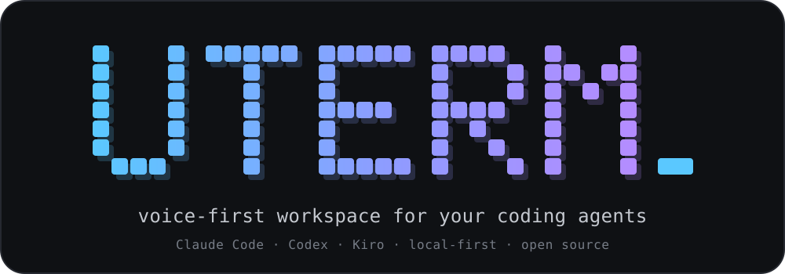
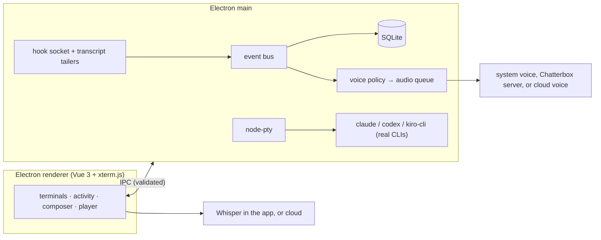

<p align="center">
  
</p>

<p align="center">
  <a href="LICENSE"></a>
  
  
  
</p>

<h3 align="center">A local-first desktop workspace for talking to your coding agents — by keyboard or by voice.</h3>

uTerm keeps the **real, interactive [Claude Code](https://www.anthropic.com/claude-code), [Codex CLI](https://github.com/openai/codex) and
[Kiro CLI](https://kiro.dev)** running in embedded terminals, and adds what the terminal alone does not give you: named and resumable
sessions, folders, a structured activity feed, spoken updates when an agent finishes or needs you, and voice input. Everything
runs on your machine; cloud voices and an English-practice coach are optional.

> It is a workspace around the CLIs, not a replacement for them: uTerm never answers a permission prompt for you and never
> puts a chat UI between you and the agent.

## Features

**Sessions**
- Several agents at once, each in its own terminal. Switching sessions never stops a process.
- Named, resumable sessions (`claude --resume`, `codex resume`, `kiro-cli chat --resume-id`) and one-click import of existing conversations.
- Nested folders with drag and drop, search, and live indicators: running sessions are highlighted with their state (ready, working, needs input, error).
- Several Claude accounts: run a session with its own config folder (for example `~/.claude-work`).
- Plain terminals: open a bare shell (no agent) next to your agent sessions for your own commands, from the `>_` button in the tab bar or the sessions header (in the selected session's folder), or from New session → Terminal. Voice input is never typed into it.
- Installed CLIs are detected automatically (including `~/.local/bin` and Homebrew folders).

**Voice, local by default, nothing to install**
- **Speech to text** with Whisper running inside the app (ONNX Runtime, no Docker, your audio never leaves the computer): record, review and edit the transcription, then send. The ~80 MB model is bundled in the macOS build and downloaded once on Linux.
- **Spoken replies** read the agent's progress, questions and results aloud according to a per-session mode (silent, essential, balanced, conversational), different for foreground and background sessions. The default voice is the one built into your computer (`say` on macOS, `espeak-ng` on Linux).
- **Settings → Voice** picks the engine for each direction: system voice, a [Chatterbox](https://github.com/resemble-ai/chatterbox) server you run yourself (natural voices, voice cloning, optional NVIDIA GPU), or a cloud provider.
- Per-chat voices, playback speed, and an audio player on every spoken message: scrub, pause and replay from memory.

**Cloud voice (optional, off by default)**
- Use **Google Gemini** or **OpenAI** voices and transcription instead of, or next to, the local ones; each chat can pick its own voice.
- One picker lists every voice (30 Gemini voices, 13 OpenAI voices, your local ones). A built-in **Test** button checks a key end to end.
- A running **estimate of cloud spend** (today, this month, all time) in the sidebar and in Settings → Usage.

**English coach (optional, off by default)**
- Practise English while you work: after a recording, see your transcription next to a more natural **B2–C1** rewrite and pick one before sending; typed prompts get the natural version shown under them in the activity feed. Display only — what is sent to the agent and what is spoken back never changes. History is kept for review.

**Agent awareness without scraping the screen**
- Claude Code via per-process hooks, Codex via transcript tailing plus hooks, Kiro via its session log — a structured activity feed (prompts, progress, results, errors) next to the terminal.
- Speech-friendly instructions are passed to each agent so long replies end with a short spoken summary (`<voice>…</voice>`) and, with Chatterbox, light expressive tags.

## Requirements
- Linux (developed and tested on Ubuntu). macOS and Windows are untested.
- Node.js ≥ 22 and `build-essential` (for node-pty). Docker is **not** needed.
- At least one agent CLI installed and logged in: Claude Code, Codex CLI or Kiro CLI.
- For voice: nothing extra for speech recognition (the Whisper model is small). On Linux install `espeak-ng` for the system voice. A Chatterbox server (optional) wants roughly 6 GB of RAM on CPU, or an NVIDIA GPU.

## Quick start
```bash
git clone https://github.com/felipewww/uterm.git
cd uterm
./scripts/setup.sh    # checks prerequisites, installs dependencies, installs hooks
./scripts/dev.sh      # launches the app (development mode). Same data, database and voice engines as the installed app
```
The scripts never run `sudo`. The first recording downloads the small Whisper model. If Electron aborts with a SUID-sandbox error, `dev.sh` falls back to `--no-sandbox` for development and prints the manual fix.

Other scripts: `./scripts/doctor.sh` (diagnostics). Optional Chatterbox server: `docker compose up -d tts` (then Settings → Voice → Output → Chatterbox server), `./scripts/tts-gpu.sh` for the GPU flavour (`--cpu` to go back), `./scripts/stop.sh` to stop it.

Your data lives in one SQLite file in the app's data folder (`~/.config/echo-term-desktop/data/uterm.db` on Linux). Coming from the older Docker/MySQL version? `cd desktop && npm i --no-save mysql2 && cd .. && node scripts/import-mysql.mjs` copies your history over (the app also moves API keys from an old `.env` file into its own encrypted store on first launch).

## Using it
- **＋** in the sessions list creates a session (agent, title, folder) or imports an existing conversation. Double-click a title to rename; right-click for more (move to folder, delete, open in VS Code…).
- The mic button, or `Ctrl+Shift+Space` (`⌘⇧Space` on a Mac), records. Review and edit the transcription, then **Send** (`Ctrl+Enter`, `⌘Enter` on a Mac, from anywhere in the window) — it goes to the session that was selected when you started recording.
- **Voice modes** per session: *Silent*, *Essential* (questions, permissions, blockers), *Balanced* (+ final results), *Conversational* (+ progress), set separately for when the session is in front and when it is in the background.
- **Notification sounds**: when an agent needs you (question, approval, blocking error) or finishes while you are looking elsewhere, a short sound plays and its tab shows *Approve* / *Answer* / *Done*; recording start and stop have their own cue. Everything is configurable in Settings → General → Notifications.
- The **STT/TTS chips** at the bottom of the sessions list show which engine is in use and whether it works; click one to change it.
- **Settings**: General (theme), Voice (default voice, speed, modes), **Voice** (speech output and input engines, Chatterbox address, API keys, models, test), English coach, Usage, Microphone, System.

## Cloud voice, keys and cost
Open **Settings → Voice**, paste your key in the OpenAI or Google Gemini section (get one at https://aistudio.google.com/apikey or https://platform.openai.com/api-keys), press **Refresh model lists** and **Test**, then pick the cloud engine for speech output and/or input. A cloud voice can also be chosen per chat.
Model names change over time, so they are editable. Costs are **estimates** computed from reported usage and public list prices; your provider's dashboard has the real bill.
Keys are typed into the app and stored encrypted by your operating system's key storage (Keychain on macOS, the keyring on Linux). They are never stored in the database, never logged, never shown again and never passed to the agents uTerm launches. See [SECURITY.md](SECURITY.md) for exactly what leaves your machine.

## Configuration
Everything is configured in the app (Settings). The only file read at the repository level is `.env`, and only by the optional Chatterbox Docker server (see `.env.example`): `TTS_PORT`, `TTS_DEVICE` (`cpu` or `cuda`), `TTS_TORCH_THREADS`, and `COMPOSE_FILE` (written by `tts-gpu.sh`).

## How it works

The terminal bytes and the structured event channel never mix: nothing is inferred by reading the screen. Details in [`docs/architecture.md`](docs/architecture.md).

## Development
```bash
cd desktop
npm run dev        # electron-vite dev server
npm run typecheck && npm run lint && npm run test && npm run build
```
- `desktop/` — Electron app (main, preload, renderer, shared types). `services/tts` — the optional Chatterbox voice server (Docker). `hooks/` — agent hook forwarder and installer. `scripts/` — setup and tooling. `docs/` — architecture, design system, validation notes.
- Add an agent by implementing `AgentAdapter` (`desktop/src/main/agents`).
- Design tokens and themes (Carbon, Islands Dark, Islands Light): [`docs/design-system.md`](docs/design-system.md).
- Contributions are welcome: see [CONTRIBUTING.md](CONTRIBUTING.md).

## Status and honesty
uTerm is young software, developed and verified on one Linux machine. [`docs/technical-validation.md`](docs/technical-validation.md) lists what was measured and, just as important, **what was not tested** (macOS, packaged builds, parts of the Kiro/Codex permission flows, live cloud providers beyond the built-in test, the microphone path on other hardware). Bug reports with `./scripts/doctor.sh` output are very welcome.

## Privacy and security
No telemetry. Ports bind to `127.0.0.1`; the hook socket is `0600`; recordings stay in memory; the optional Chatterbox container does not mount your home folder or agent credentials; API keys live only in the app's encrypted key store. Cloud features are opt-in and listed, with exactly what they send, in [SECURITY.md](SECURITY.md), which also explains how to report a vulnerability.

## License
[MIT](LICENSE). Third-party components and trademark notes: [THIRD_PARTY.md](THIRD_PARTY.md).
uTerm is an independent project, not affiliated with Anthropic, OpenAI, Google or Amazon.
